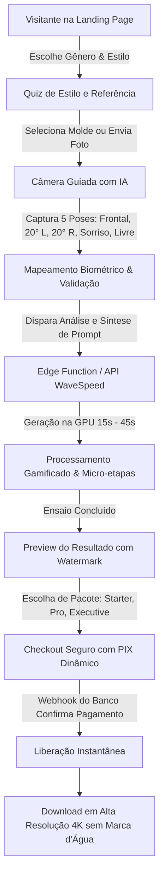

# ARQUITETURA DE SISTEMA & FUNIL — FOTOFLOW

> Documento de referência arquitetural, fluxo do funil de conversão, modelo de dados e cronograma de construção em 12 etapas.

---

## 1. DIAGRAMA DE FLUXO DO FUNIL (MERMAID)

---

## 2. JORNADA COMPLETA DO PRIMEIRO CLIQUE AO DOWNLOAD

1. **Descoberta & Landing Page:**
   - O usuário acessa a página inicial, visualiza o slider interativo antes/depois e clica no botão principal *"Criar Meu Ensaio"*.
2. **Filtro de Gênero & Estilo:**
   - Seleciona Masculino ou Feminino e escolhe entre 4 estilos (Corporativo, Lifestyle, Aniversário com Vela Sparkler, Pet).
3. **Seleção da Referência:**
   - O cliente escolhe um molde pré-configurado do catálogo ou carrega uma imagem de referência personalizada.
4. **Captura na Câmera Guiada (5 Poses):**
   - Através da câmera do celular/computador com auxílio de Face Landmarker, o usuário captura: (1) Frontal neutro, (2) 20° para a esquerda, (3) 20° para a direita, (4) Sorriso natural e (5) Ângulo espontâneo.
5. **Normalização e Pré-processamento:**
   - As fotos são redimensionadas para resolução adequada (1024px) com compressão otimizada sem perda de nitidez ocular.
6. **Injeção do Prompt Mestre & Síntese:**
   - O sistema compõe o prompt mestre garantindo que 100% da identidade facial do cliente seja preservada e que o cenário/roupa da referência sejam recriados organicamente (sem corte/cola).
7. **Processamento Gamificado na GPU:**
   - Enquanto a GPU processa na WaveSpeed AI, a barra de progresso exibe mensagens realistas sobre microporos, iluminação de estúdio e retoque executivo suave.
8. **Exibição do Preview:**
   - A foto é apresentada com marca d'água elegante e opção de comparação direta lado a lado com as fotos originais.
9. **Seleção de Pacote & Pagamento:**
   - O usuário escolhe o pacote de fotos e recebe o QR Code e código Copia e Cola do PIX.
10. **Confirmação Automática & Liberação:**
    - O webhook do banco valida a liquidação do PIX e altera o status do pedido para `pago`.
11. **Download do Arquivo Original:**
    - O cliente recebe o link seguro para baixar a foto final em alta resolução 4K sem marca d'água.
12. **Retenção & Re-engajamento:**
    - Disparo de evento de conversão server-side via Meta CAPI e opção de gerar novos estilos com o mesmo cadastro.

---

## 3. MAPA DE ROTAS E COMPONENTES

| Rota / Etapa | Componente Responsável | Papel no Funil |
| :--- | :--- | :--- |
| `/` | `src/pages/HomePage.tsx` | Container principal do SPA |
| `Header` | `src/components/layout/Navbar.tsx` | Navegação, atalho de prompts e download |
| `Hero` | `src/features/landing/HeroSection.tsx` | Proposta de valor e provas sociais |
| `Etapa 1` | `src/pages/HomePage.tsx` (Seção 1) | Escolha de molde e referência de estúdio |
| `Etapa 2` | `src/components/GuidedCameraModal.tsx` | Feed de câmera e captura das 5 poses |
| `Etapa 3` | `src/pages/HomePage.tsx` (Seção 3) | Seleção de técnica e retoque executivo |
| `Etapa 4` | `src/components/ui/progress.tsx` | Barra de carregamento e micro-etapas |
| `Etapa 5` | `src/pages/HomePage.tsx` (Seção 5) | Preview, comparador e paywall com PIX |
| `Footer` | `src/components/layout/Footer.tsx` | Informações legais e de segurança |

---

## 4. MODELO DE DADOS CONSOLIDADO (ENTIDADES)

- **Lead:** `id`, `nome`, `email`, `telefone`, `genero`, `estiloId`, `etapaAtual`, `status`, `utm`, `criadoEm`.
- **Estilo:** `id`, `slug`, `nome`, `descricao`, `ativo`, `ordem`.
- **Referencia:** `id`, `estiloId`, `titulo`, `urlImagem`, `genero`, `ativo`, `ordem`.
- **Ensaio:** `id`, `leadId`, `estiloId`, `referenciaId`, `status`, `urlPreview`, `urlFinal`, `promptUsado`, `criadoEm`.
- **Pacote:** `id`, `slug`, `quantidadeFotos`, `precoCentavos`, `ativo`.
- **Pedido:** `id`, `leadId`, `pacoteId`, `status`, `provedor`, `pixCopiaECola`, `pagoEm`, `criadoEm`.
- **EventoTracking:** `id`, `leadId`, `evento`, `payload`, `criadoEm`.

---

## 5. CRONOGRAMA DE CONSTRUÇÃO EM 12 ETAPAS

1. **Etapa 1 — Setup Base:** Configuração de Vite, TypeScript, Tailwind tokens e `components.json`.
2. **Etapa 2 — Banco de Dados:** Execução das migrações `001_core.sql` e `002_storage.sql` no Supabase.
3. **Etapa 3 — Camada de Serviço:** Implementação dos adaptadores `mock.ts` e `supabase.ts` em `src/lib/api/`.
4. **Etapa 4 — Landing Page:** Construção da Hero Section com comparador antes/depois e CTA.
5. **Etapa 5 — Seletor de Estilos e Catálogo:** Grid de cenários de estúdio com filtros dinâmicos.
6. **Etapa 6 — Modal de Câmera Guiada:** Integração de WebRTC e MediaPipe Face Landmarker para 5 poses.
7. **Etapa 7 — Orquestração de Prompts:** Injeção do prompt mestre de fusão orgânica e retoque executivo.
8. **Etapa 8 — Integração WaveSpeed:** Edge Function `gerar-ensaio` com suporte a Google e OpenAI.
9. **Etapa 9 — Gamificação do Loading:** Transição de etapas e micro-mensagens educativas de estúdio.
10. **Etapa 10 — Sistema de Paywall & PIX:** Edge Function `pix-webhook` com verificação e liberação automática.
11. **Etapa 11 — Tracking & Conversões:** Implementação de `track.ts` e Edge Function `meta-capi`.
12. **Etapa 12 — Otimizações & Deploy:** Ajuste de cache, compressão WebP e exportação definitiva.
